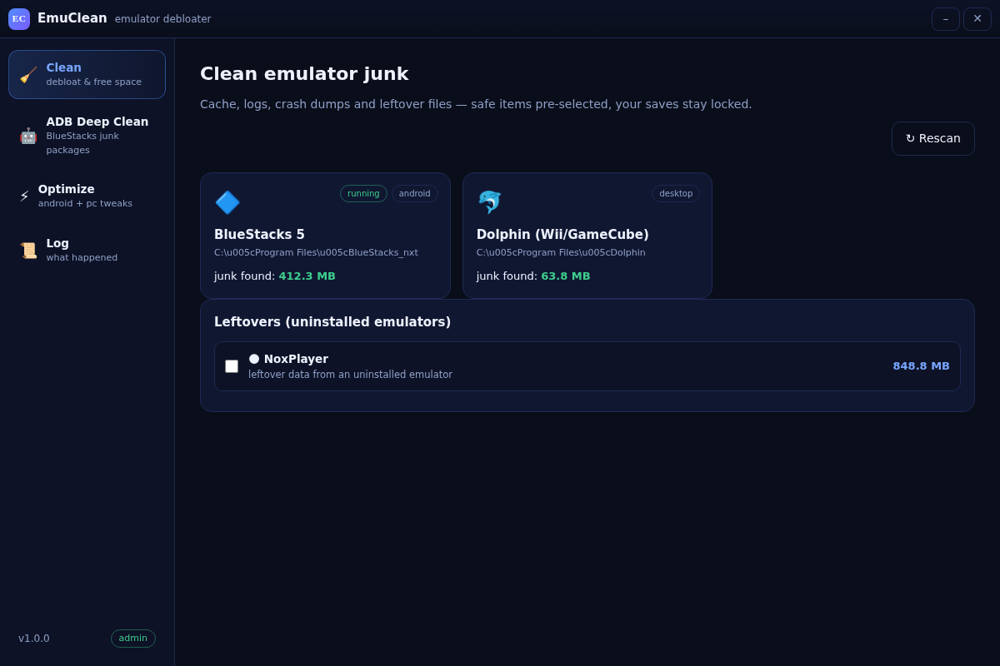
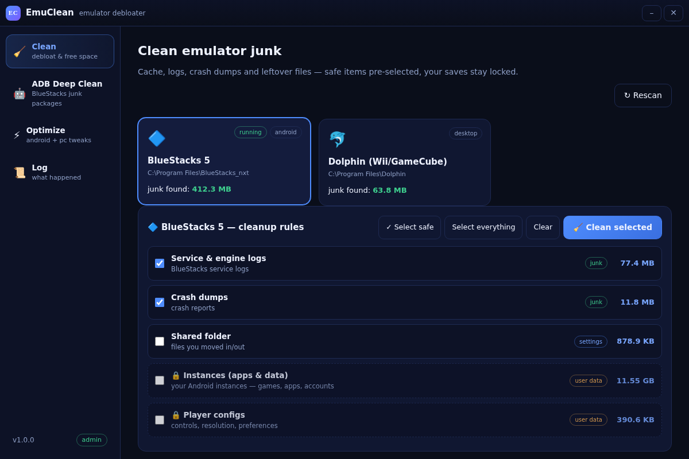
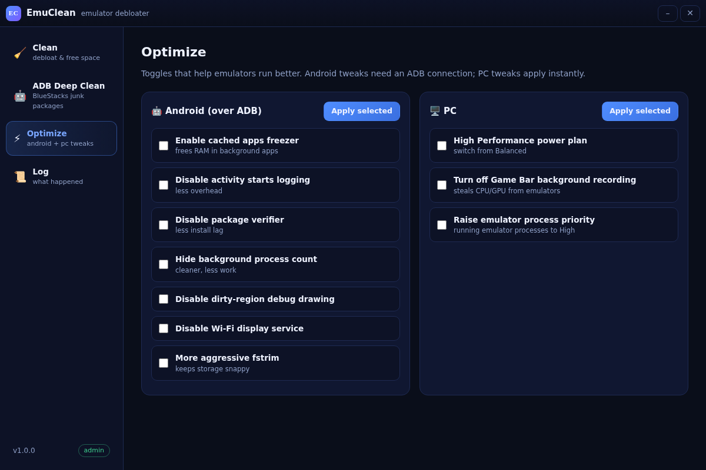

<div align="center">

# 🧹 EmuClean

**Emulator Debloater & Optimizer — ek hi kaam, achhe se.**

Auto-detects your installed emulators, cleans their junk **safely into the Recycle Bin**,
and optimizes Android + PC settings for them.

[](https://github.com/adityagg13/EmuClean/releases/latest)
[](https://github.com/adityagg13/EmuClean/releases/latest)
[](https://github.com/adityagg13/EmuClean)
[](LICENSE)

### 📥 [Download the latest EXE →](https://github.com/adityagg13/EmuClean/releases/latest)

*Extract the zip → run `EmuClean.exe` → allow the UAC prompt. That's it.*

</div>

---

## What it does

| Mode | Description |
|---|---|
| 🧹 **Clean** | Finds **junk only** (logs, cache, shader cache, crash dumps) for every detected emulator — auto-selected and pre-sized. **Saves, BIOS, memory cards and instance disks stay locked 🔒 and are never auto-touched.** Every delete goes to the **Recycle Bin**, so a mistake is always reversible. Also scans for **leftover folders** from uninstalled emulators. |
| 🤖 **ADB Deep Clean** | For BlueStacks: connects over `HD-Adb.exe` and removes **preinstalled junk packages** with three profiles (Safe / Balanced / Aggressive). A hard **core safe-list** (phone, settings, GMS, launcher…) can never be selected. |
| ⚡ **Optimize** | Android (over ADB): cached-apps freezer, activity logging off, package verifier off… PC: **High Performance power plan**, **GameDVR off**, **High priority** for running emulator processes. |

## Screenshots

| | |
|---|---|
|  |  |
| *Detected emulators + junk size* | *Junk auto-checked, user data 🔒 locked* |


*Android + PC optimization toggles*

## Supported emulators (25)

**Android:** BlueStacks 4/5 · LDPlayer 9 · NoxPlayer · MEmu · Gameloop · MuMu Player · KOPlayer · Genymotion
**Console/desktop:** Dolphin · PCSX2 · RPCS3 · Yuzu · Suyu · Ryujinx · Lime3DS/Citra · PPSSPP · Cemu · Xenia · DuckStation · RetroArch · mGBA · Project64 · Vita3K · xemu

## Safety design

- **Junk-only auto selection** — the engine separates regenerable junk from user data; only `junk` items are auto-checked
- 🔒 **Locked categories** — saves/memcards/BIOS/instances are shown with a lock, never auto-selected, and warn if you check them
- ♻️ **Recycle Bin deletes** — `SHFileOperation`-level recycle, so "clean" is reversible until you empty the bin
- 🛡️ **Core Android safe-list** — 22 system packages are hard-blocked from removal
- UAC admin is requested up-front (folder cleaning + ADB need it)

## Requirements

- Windows 10 / 11 (`.NET Framework 4.8` is built into both)
- **WebView2 Runtime** — preinstalled on Windows 11 and most Windows 10 installs; if missing, grab it from [Microsoft](https://developer.microsoft.com/microsoft-edge/webview2/)
- BlueStacks must be **running** for the ADB page

## Build from source

```bash
dotnet build -c Release          # or: dotnet publish -c Release
# output: EmuClean/bin/Release/publish/  (EmuClean.exe + ui/)
```

Project layout:

```
EmuClean/
├── EmuClean.csproj      net48 + WebView2 host
├── app.manifest         requireAdministrator
├── Program.cs           entry point
├── Host.cs              frameless WebView2 form + JS↔C# bridge
└── Engine/
    ├── Detector.cs      25 emulators: paths, registry, processes
    ├── Cleaner.cs       junk scan, sizing, recycle-safe delete
    ├── AdbManager.cs    BlueStacks ADB + junk profiles + safe-list
    ├── Optimizer.cs     android + pc tweaks
    └── Api.cs           bridge surface used by the UI
ui/                      HTML/CSS/JS interface (works standalone as a preview)
```

## License

MIT — see [LICENSE](LICENSE).
